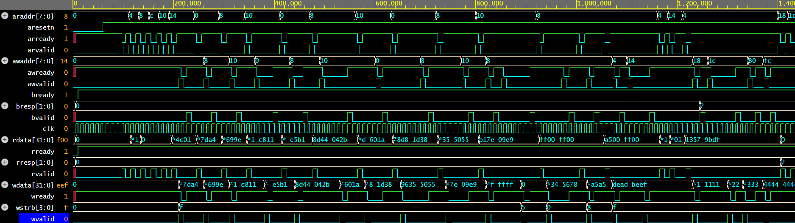
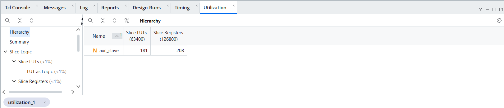
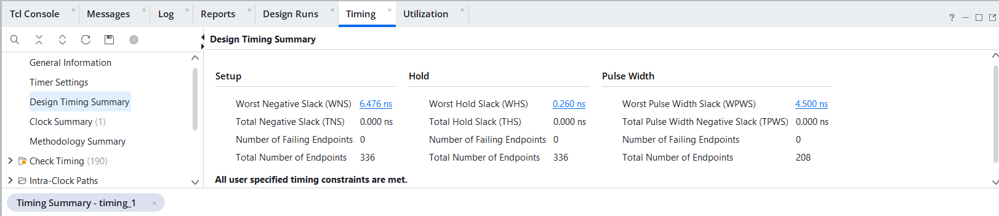

# AXI4-Lite Slave Register Interface with SystemVerilog Assertions

An AXI4-Lite slave in SystemVerilog that gives software access to a small
control/status register block: read/write registers, read-only status,
a write-1-to-clear interrupt register with masking, and an ID register.
It is verified with a self-checking testbench (AXI master BFM, register model
scoreboard, random back-pressure, functional coverage) and 22 SVA protocol and
register-file assertions attached through `bind`.

## Features

- Full AXI4-Lite handshake on all five channels (AW, W, B, AR, R)
- **AW and W accepted in any order**: address first, data first, or the same cycle
- Write response only after both address and data have been received
- `WSTRB` byte enables on every writable register
- `SLVERR` for unmapped addresses (read data returns 0)
- Read and write paths are independent and can be active at the same time
- **Write-1-to-clear** interrupt status with enable mask and `irq_o` output;
  a hardware event in the same cycle as a clear is never lost
- Responses held stable under back-pressure (`BREADY` / `RREADY` low)
- Synchronous active-low reset (AXI `ARESETn` convention)
- Parameterized address width and ID value

## Register Map

| Offset | Name         | Access | Reset         | Description                              |
|--------|--------------|--------|---------------|------------------------------------------|
| 0x00   | `CTRL`       | RW     | `0x0000_0000` | Control bits, driven on `ctrl_o`         |
| 0x04   | `STATUS`     | RO     | -             | Live value of `status_i`                 |
| 0x08   | `SCRATCH`    | RW     | `0x0000_0000` | Scratch register for software bus tests  |
| 0x0C   | `IRQ_STATUS` | RW1C   | `0x0000_0000` | Set by `irq_set_i`, write 1 to clear     |
| 0x10   | `IRQ_ENABLE` | RW     | `0x0000_0000` | Interrupt mask                           |
| 0x14   | `ID`         | RO     | `ID_VALUE`    | Identification (`0x4158_4C01` default)   |
| other  | -            | -      | -             | `SLVERR` response, read data 0           |

`irq_o = |(IRQ_STATUS & IRQ_ENABLE)`. Writes to read-only registers are
ignored and return `OKAY`.

## Block Diagram

```
                   ┌──────────────────────────── axil_slave ───────────────────────────┐
  AW (addr) ──────►│ AW holding reg ─┐                                                 │
                   │                 ├─► do_write ─► register file ──► ctrl_o, irq_o   │
  W (data,strb) ──►│ W  holding reg ─┘       │        CTRL  SCRATCH                    │
                   │                         ▼        IRQ_STATUS (W1C)  ◄── irq_set_i  │
  B (resp) ◄───────│                    B response    IRQ_ENABLE                       │
                   │                                  STATUS ◄── status_i   ID         │
  AR (addr) ──────►│ address decode ─► read mux ─► R data/resp register ───────────────│──► R (data,resp)
                   └───────────────────────────────────────────────────────────────────┘
```

## Interface

| Group     | Signals                                                                 |
|-----------|-------------------------------------------------------------------------|
| Clock/reset | `s_axi_aclk`, `s_axi_aresetn` (synchronous, active low)              |
| AW        | `s_axi_awaddr`, `s_axi_awprot`, `s_axi_awvalid`, `s_axi_awready`        |
| W         | `s_axi_wdata`, `s_axi_wstrb`, `s_axi_wvalid`, `s_axi_wready`            |
| B         | `s_axi_bresp`, `s_axi_bvalid`, `s_axi_bready`                           |
| AR        | `s_axi_araddr`, `s_axi_arprot`, `s_axi_arvalid`, `s_axi_arready`        |
| R         | `s_axi_rdata`, `s_axi_rresp`, `s_axi_rvalid`, `s_axi_rready`            |
| User      | `ctrl_o[31:0]`, `status_i[31:0]`, `irq_set_i[31:0]`, `irq_o`            |

| Parameter    | Default        | Description                    |
|--------------|----------------|--------------------------------|
| `ADDR_WIDTH` | 8              | Byte address width (>= 5)      |
| `ID_VALUE`   | `32'h4158_4C01`| Value of the read-only ID register |

## Design Notes

**Independent AW and W.** AXI does not guarantee that address and data
arrive together. Each channel has its own holding register; `AWREADY` /
`WREADY` are high whenever that register is empty. The register write
(`do_write`) happens once both are held and the B channel is free.

**Valid never waits for ready.** `BVALID` and `RVALID` are asserted as soon as
the response exists and stay high, with stable `BRESP` / `RDATA` / `RRESP`,
until the master asserts `BREADY` / `RREADY`. This avoids the classic AXI
deadlock where both sides wait for each other.

**One outstanding transaction per direction.** `ARREADY` is low while a read
response is waiting, and a new write is performed only when the B channel is
free. This keeps the slave small. Throughput is one read every two cycles
and up to one write every two cycles, which is typical for a control-register
slave.

**Write-1-to-clear with set priority.** `IRQ_STATUS` updates as
`(status & ~clear) | irq_set_i`, so if hardware raises an interrupt in the
same cycle software clears it, the new event survives.

**No read side effects.** Reading any register never changes state, so a
debugger or a speculative read cannot lose an interrupt.

**Synchronous reset.** AXI specifies that `ARESETn` is sampled on the clock;
all `VALID` outputs are low during reset.

## Verification

### Testbench (`tb/tb_axil_slave.sv`)

- **AXI master BFM** tasks: `axi_write` (AW/W same cycle, AW first, or W first,
  with random delays) and `axi_read`
- **Random back-pressure** on `BREADY` and `RREADY`
- **Register model scoreboard**: every `BRESP`, `RDATA`, `RRESP`, `ctrl_o` and
  `irq_o` is compared with the model

| Test | Scenario                                                           |
|------|--------------------------------------------------------------------|
| T1   | Reset values of all registers                                      |
| T2   | Write/read every RW register with all three AW/W orderings         |
| T3   | `WSTRB` byte enables (partial, none, single byte)                  |
| T4   | Read-only registers ignore writes; `STATUS` follows `status_i`     |
| T5   | Unmapped addresses return `SLVERR` and zero data                   |
| T6   | `IRQ_STATUS` write-1-to-clear, strobed clear, `irq_o` masking      |
| T7   | Hardware interrupt in the same cycle as a W1C clear (set wins)     |
| T8   | 2000 random transactions (random address, data, strobe, ordering) with 50 % back-pressure |
| T9   | Read and write streams running concurrently                        |
| T10  | Reset returns all registers to their reset values                  |

- **Functional coverage**: register × AW/W ordering cross, strobe types,
  OKAY/SLVERR for writes and reads

### Assertions (`sva/axil_slave_sva.sv`)

22 assertions, 3 master assumptions, 9 cover properties.

| Category              | Properties checked                                                    |
|-----------------------|-----------------------------------------------------------------------|
| Reset                 | `BVALID` / `RVALID` low after reset                                   |
| Response stability    | `BVALID`/`RVALID` held until ready; `BRESP`/`RDATA`/`RRESP` stable    |
| Response ordering     | B only after both AW and W; R only after AR; outstanding limits       |
| Legal responses       | Only OKAY / SLVERR; SLVERR reads return 0                             |
| X-checks              | No X/Z on handshakes, responses or `irq_o`                            |
| Register rules        | CTRL / SCRATCH / IRQ_ENABLE change only on a write to them            |
| Interrupts            | Bits set only by hardware, cleared only by W1C, set wins, `irq_o` correct |
| Master assumptions    | AW / W / AR valid and payload stable until handshake                  |
| Cover properties      | AW before W, W before AW, same cycle, back-pressure, read/write overlap, SLVERR, set+clear same cycle |

## How to Run

**EDA Playground:** paste `rtl/axil_slave.sv` and `sva/axil_slave_sva.sv` into
the Design box and `tb/tb_axil_slave.sv` into the Testbench box. Set Top module
to `tb_axil_slave`, choose Siemens Questa, tick "Open EPWave after run".

**Questa / ModelSim:**
```
cd sim
vsim -c -do run_questa.do
```

**Vivado simulator:**
```
cd sim
sh run_xsim.sh
```

**Vivado synthesis:** add `rtl/axil_slave.sv` as a design source and
`constraints/axil_slave.xdc` as the constraint file, synthesis option
`-mode out_of_context`.

## Results

| Metric                    | Value |
|---------------------------|-------|
| Simulator                 | Questa 2025.2 (EDA Playground) |
| Transactions checked      | 1,291 writes / 1,377 reads (2,668 total) |
| Write orderings           | 416 AW+W same cycle / 429 AW first / 446 W first |
| Responses                 | 2,079 OKAY / 589 SLVERR |
| Scoreboard errors         | 0 |
| Assertion failures        | 0 (22 assertions, 3 assumptions, 9 covers) |
| Functional coverage       | 100 % write / 100 % read |
| FPGA part                 | xc7a100tcsg324-1 (Arty A7-100T) |
| Synthesis tool            | Vivado (post-synthesis, out-of-context) |
| Slice LUTs / FFs          | 181 / 208 |
| Timing (10 ns clock)      | WNS +6.476 ns, WHS +0.260 ns, all constraints met |
| Fmax (estimate)           | ~284 MHz |





Full simulation log: [sim/sim_log.txt](sim/sim_log.txt)

